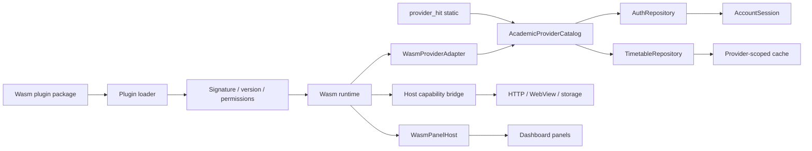

# Wasm Plugin System Design

Status: **planned, not implemented**. The current app ships compile-time providers and compile-time dashboard panels; no Wasm runtime or runtime plugin loader exists yet.

## Decision

- Runtime plugins use one portable format: a signed WebAssembly module plus a manifest.
- Two plugin kinds are supported:
  - **academic provider**: login, terms, timetable, future scores/exams;
  - **dashboard panel**: timer, weather, homework list, and similar Today panels.
- HIT Shenzhen/Harbin/Weihai remain compile-time Dart providers in `packages/provider_hit`.
- Existing `OmniPlugin` panels/pages remain compile-time UI extensions. They are not the runtime plugin format.
- Wasm plugins do not render Flutter widgets. The host renders UI from panel templates or a limited declarative UI tree.
- Runtime code never becomes a Dart object; it is wrapped by host adapters (`WasmProviderAdapter`, `WasmPanelHost`).
- No downloaded Dart code and no downloaded native libraries.

### iOS builds

Dynamic plugins are supported only in the **iOS sideload build**, not the App Store build:

| Build | Dynamic Wasm | Static HIT providers | Purpose |
| --- | --- | --- | --- |
| `ios-appstore` | disabled / loader compiled out | yes | Normal App Store distribution |
| `ios-sideload` | enabled, experimental | yes | AltStore/SideStore, development or advanced users |
| Android / desktop | enabled | yes | Normal runtime plugin targets |
| Web | enabled separately | yes | Browser Wasm runtime with CSP/CORS handling |

The App Store binary must not contain the runtime loader or downloaded plugin code. The sideload build may include a Wasm interpreter, but not a JIT or dynamically loaded native code.

## Why Wasm

- One format for Android, Windows, Linux, macOS, iOS sideload, and (separately) Web.
- Sandboxed execution with explicit host capabilities.
- No downloaded native libraries and no downloaded Dart code.
- Host APIs can be versioned independently of the app UI.
- The same provider/panel plugin can run on native interpreters and in the browser.

## Plugin Kinds

| Kind | Contributes | Host adapter |
| --- | --- | --- |
| Academic provider | login, terms, timetable snapshot, future scores/exams | `WasmProviderAdapter` |
| Dashboard panel | panel state and UI data; timer, weather, homework list | `WasmPanelHost` |
| UI plugin | compile-time Flutter panels/pages | existing `OmniPlugin`, not Wasm |

A Wasm package may contain a provider, one or more panels, or both. A panel-only plugin still goes through the same manifest, signature, permission, and lifecycle checks.

## Architecture



Static HIT providers and compile-time `OmniPlugin` panels are independent of the Wasm runtime. A runtime failure must never disable them.

## Plugin Package

```text
example.school-1.0.0.zip
  manifest.json
  plugin.wasm
  signature.ed25519
```

Manifest example:

```json
{
  "id": "example.school",
  "name": "示例大学",
  "version": "1.0.0",
  "hostApi": 1,
  "minAppVersion": "1.0.0",
  "entry": "plugin.wasm",
  "sha256": "<wasm sha256>",
  "publisher": "example-university",
  "platforms": ["android", "windows", "linux", "macos", "web", "ios-sideload"],
  "permissions": [
    "http:jw.example.edu.cn",
    "webview:https://sso.example.edu.cn",
    "storage",
    "notifications"
  ],
  "provider": {
    "displayName": "示例大学",
    "school": "示例大学",
    "campusLabel": "主校区",
    "authModes": ["password", "webview"]
  },
  "panels": [
    {
      "id": "focus",
      "title": "番茄钟",
      "template": "timer",
      "defaultEnabled": false,
      "permissions": ["notifications", "storage"]
    },
    {
      "id": "weather",
      "title": "天气",
      "template": "weather",
      "defaultEnabled": false,
      "permissions": ["http:api.weather.example"]
    }
  ]
}
```

Rules:

- `id` is stable and globally unique. Built-in IDs such as `hit.*` cannot be overridden.
- The signature covers the canonical manifest plus the wasm hash.
- The app pins trusted publisher keys; unknown publisher keys are rejected.
- `hostApi` is checked before instantiation. Incompatible plugins are not loaded.
- `platforms` is checked against the current build. `ios-sideload` is never accepted by `ios-appstore`.
- Permissions are enforced by the host bridge, not by the plugin.
- A panel manifest may reference only host-known templates or the supported UI schema.

## Wasm ABI v1

The runtime uses a JSON-over-linear-memory protocol. This keeps the ABI language-agnostic and avoids coupling plugins to Dart, Flutter, or WASI networking.

### Exports

```text
plugin_abi_version() -> i32
plugin_alloc(size: i32) -> i32
plugin_free(ptr: i32, len: i32)
plugin_handle(op: i32, input_ptr: i32, input_len: i32) -> i64
plugin_resume(input_ptr: i32, input_len: i32) -> i64
```

`i64` result packs `(ptr << 32) | len`. The host copies the JSON output, then calls `plugin_free`.

### Provider operations

| `op` | Input | Output |
| --- | --- | --- |
| `1` | `login` request | auth session or effect |
| `2` | `fetchTerms` request | term list or effect |
| `3` | `fetchSnapshot` request | canonical snapshot or effect |

### Panel operations

| `op` | Operation | Output |
| --- | --- | --- |
| `10` | `panel.init(config, instanceState?)` | initial state |
| `11` | `panel.build(state)` | template data or UI tree |
| `12` | `panel.event(event)` | updated UI tree |
| `13` | `panel.tick(now)` | updated UI tree |
| `14` | `panel.configChanged(config)` | updated state/UI |
| `15` | `panel.save(state)` | opaque state bytes |
| `16` | `panel.dispose()` | acknowledgement |

Each panel instance has isolated state. A plugin module is loaded once per package; the host creates instances per panel ID.

### Async effects

Wasm host calls are synchronous; Dart HTTP/WebView are asynchronous. The ABI therefore uses an effect loop instead of blocking FFI:

```json
{"type":"effect","effect":{"kind":"http","request":{"method":"GET","url":"...","headers":{},"body":null}}}
```

or:

```json
{"type":"done","value":{}}
```

The host executes the effect asynchronously, then calls `plugin_resume` with the result. Plugin state remains inside the wasm instance for the duration of one operation. This avoids deadlocks and works the same way in native and browser runtimes.

Synchronous host imports are limited to operations with no I/O wait:

- `storage_get` / `storage_set` / `storage_remove`
- `now`
- `random`
- `crypto` (RSA PKCS#1 v1.5, AES, SHA-256, HMAC)
- `log` (redacted)

## Panel Plugins

A panel is the runtime equivalent of a small stateful widget, but the Wasm side owns **state and logic**, not Flutter elements.

### Lifecycle mapping

| Flutter concept | Plugin operation |
| --- | --- |
| `initState` | `panel.init(config)` |
| `build` | `panel.build(state)` |
| `setState` | return a new UI tree/data |
| `didUpdateWidget` | `panel.configChanged(config)` |
| `dispose` | `panel.dispose()` |
| state restoration | `panel.save` / `panel.init(instanceState)` |

The host keeps the Flutter widget alive, invokes plugin operations, diffs/renders the result, and forwards user events.

### UI rendering choices

1. **Host templates (recommended first)**
   - `timer`: remaining time, running state, progress, primary action.
   - `weather`: current condition, temperature, location, forecast.
   - `list`: homework/assignments with title, subtitle, due time, status.
   - The plugin supplies validated data; the host owns layout and theming.
2. **Declarative UI tree (second phase)**
   - Limited components: column, row, text, icon, button, progress, list, input, toggle.
   - The plugin returns a UI tree; events carry component IDs.
   - The host validates depth, types, sizes, and text length.
3. **WebView panel (exception)**
   - The plugin ships HTML/JS or a Wasm UI inside a host WebView.
   - Use only for trusted, reviewed plugins that need custom UI.
   - Theme, accessibility, input, CORS, and performance costs are higher.
   - On Web, use a sandboxed iframe/Worker equivalent.

### State and scheduling

- The host persists opaque panel state per plugin and panel instance.
- The host supplies ticks; the plugin must not sleep or rely on wall-clock loops.
- Pomodoro timing uses a host monotonic clock and a host notification at completion.
- A running timer may pause when the app is suspended; completion notifications must be scheduled by the host, not by a sleeping Wasm instance.
- Panels refresh on visibility, user action, or a host-scheduled interval. Background intervals are best-effort and platform-limited.

### Panel authentication

Panels that need a school platform session must use host-managed authentication:

1. The panel declares an auth requirement and allowed domains.
2. The host opens a WebView for SSO/WebVPN, if needed.
3. The host stores a scoped session (cookies/token) in secure storage.
4. The panel requests HTTP through the host; the host injects the scoped session.
5. The panel never receives another plugin's credentials.
6. Session expiry triggers a host event and a re-login action.

This covers login-protected homework panels without allowing arbitrary credential reads.

### Example capabilities

| Panel | State | Host capabilities |
| --- | --- | --- |
| Pomodoro | remaining time, running, session count | tick, notifications, storage |
| Weather | last payload, refresh time | HTTP, storage/cache |
| Homework | assignments, last sync, session handle | HTTP, WebView auth, storage, refresh |

## Host Capabilities

| Capability | Form | Restrictions |
| --- | --- | --- |
| HTTP | effect | Domain allowlist, method allowlist, timeout, response-size cap |
| WebView auth | effect | Start URL, success matcher, cookie names; platform opt-in |
| Session/auth | host-managed | Per-plugin and per-account scope; no raw credential export |
| Cookies | host-managed | Per-plugin scope |
| Storage | synchronous import | Per-plugin namespace |
| Notifications | effect | Explicit permission; platform limits |
| Clipboard / open URL | effect | Explicit permission |
| Crypto | synchronous import | Fixed algorithms, no key export |
| Time/random | synchronous import | No side effects |
| Timer ticks | host-driven | Panel visible/active; best-effort background |
| Filesystem/process/socket | unavailable | Sandbox boundary |

Plugins return only validated data:

- provider: `credentials`, `cookies`, `profile`, `Term`, `TimetableSnapshot`
- panel: template data or validated UI tree

The host validates required fields, integer ranges, week/period bounds, panel tree depth/size, and snapshot size before accepting data.

## Runtime

- Native Android/desktop: WAMR, wasm3, or Wasmtime C API behind a `WasmRuntime` interface.
- iOS sideload: Wasm interpreter only (WAMR/wasm3 class). No JIT, no downloaded native code.
- Web: browser `WebAssembly` with the same JSON ABI and a JavaScript host bridge.
- Runtime must support memory limits, execution timeouts, and deterministic instance teardown.
- The app ships the native runtime only in builds where dynamic plugins are enabled.
- The `ios-appstore` build ships no runtime and no loader symbol path.

## iOS Builds

### `ios-appstore`

- Static HIT providers and compile-time `OmniPlugin` panels only.
- Wasm runtime, plugin downloader, and dynamic panel host are compiled out or hard-disabled.
- Plugin manifests with `ios-sideload` or other dynamic platforms are not requested.
- This preserves the normal App Store distribution model.

### `ios-sideload`

- Experimental, advanced-user build.
- Same Wasm ABI, interpreter, host capabilities, and panel templates as other native targets.
- Manifest platform tag: `ios-sideload`.
- No JIT and no downloaded `.dylib`/framework; only `.wasm` and static assets.
- Uses WKWebView for host-managed login and optional WebView panels.
- Uses Keychain or an encrypted app-private store for scoped sessions.

Distribution limits:

- AltStore/SideStore/free certificates normally require periodic re-signing (often 7 days); paid certificates last longer.
- Device limits, installation friction, and manual updates remain.
- Enterprise certificates are for internal employees, not public distribution.
- TrollStore/jailbreak paths are version-specific and not a general product strategy.
- Even without App Store review, Apple developer/enterprise agreements still apply.
- The sideload build is not a promise of mainstream iPhone support.

## Security

- Signed packages; pinned publisher keys; revocation list.
- Host-enforced domain allowlist; no arbitrary HTTP from plugin code.
- Per-plugin cookie/storage/session isolation.
- Resource limits: memory, execution time, input/output size, concurrent operations.
- Plugins cannot access Flutter controllers, other plugins, or the global store.
- Credentials are managed by the host; plugins receive scoped sessions, not raw passwords.
- External plugins still require code review; the sandbox is not a substitute for trust.
- Updates support staged rollout, rollback, and a kill switch.
- Sideload builds add risk because users may install plugins outside the normal trust channel; publisher warnings and explicit consent are required.

## Static HIT Providers

`packages/provider_hit` remains the reference implementation:

- `hit.shenzhen` uses the new EAS API and is available.
- `hit.harbin` and `hit.weihai` are explicit unavailable WebVPN placeholders.
- HIT campus schedules and `Campus` concepts stay inside the package.
- The app catalog always contains these providers; plugin runtime failure must not affect them.

## App Integration

- `AcademicProviderCatalog` is the single provider routing point.
- Login page lists static and installed dynamic providers from the catalog.
- Session and cache are keyed by `providerId`.
- The empty timetable uses provider metadata (`defaultSlots`) instead of a campus switch.
- Dynamic dashboard panels are added to the existing dashboard layout by namespaced panel ID.
- A missing or disabled plugin renders an unavailable placeholder or is hidden from the add-panel list; it must not break the layout.
- HIT providers and compile-time panels remain available if the runtime fails.
- `OmniPlugin` remains the compile-time UI extension mechanism; Wasm panels use `WasmPanelHost`.

## Lifecycle

1. Fetch or import a plugin package.
2. Verify signature, hash, host API, min app version, platform, and publisher key.
3. Store under an app-private versioned directory.
4. Instantiate on demand; validate ABI and manifest metadata.
5. Add provider/panel adapters to the volatile registries.
6. On failure, disable the plugin and keep static providers/panels available.
7. On update, install side-by-side, validate, then switch active version.
8. On uninstall, remove plugin state only after explicit confirmation.

## Implementation Phases

1. **Current**: `academic_api` + static `provider_hit` + static dashboard panels; no Wasm.
2. Define provider/panel ABI v1, manifest schema, Rust plugin SDK, and contract test kit.
3. Implement a native runtime spike on desktop + Android; verify effect loop, panel ticks, memory cap, and timeout.
4. Implement package download/import, signature verification, install/update/rollback.
5. Add `WasmProviderAdapter`, dynamic catalog entries, and provider-scoped UI/session/cache.
6. Add `WasmPanelHost` and template panels: timer, weather, list.
7. Add host-managed WebView auth and scoped sessions for homework panels.
8. Add the `ios-sideload` build and interpreter; keep `ios-appstore` loader-free.
9. Add Web runtime separately, including CSP/CORS handling.
10. Add plugin review, publisher trust store, telemetry/redaction, and kill switch.

## Acceptance Criteria

- Static HIT login/sync and built-in panels work with no Wasm runtime present.
- A signed Wasm provider plugin can be installed, appears in the login page, and syncs a canonical timetable.
- A signed Wasm timer/weather/homework panel can be added to Today and survives app restart.
- The homework panel can authenticate through the host, refresh its list, and never reads another plugin's session.
- Tampered or unsigned packages are rejected.
- A plugin cannot access an undeclared domain, another plugin's storage, or the filesystem.
- Infinite loops and memory exhaustion are terminated without crashing the app.
- Two providers'/plugins' sessions and caches remain isolated.
- The `ios-appstore` build contains no runtime loader and cannot install plugins.
- The `ios-sideload` build can install a signed test plugin using the same Wasm package.

## Non-goals

- Loading arbitrary Dart or native code.
- Rendering arbitrary plugin-provided Flutter widgets.
- Dynamic plugins in the iOS App Store build.
- A public plugin marketplace in the first implementation.
- Guaranteed background execution of panel timers.
- Server-side credential handling.
- Mainstream distribution of the iOS sideload build.

## Platform Notes

- Android direct APK distribution has the fewest constraints. Google Play still reviews dynamic code loading; Android 14+ also restricts dynamically loaded files.
- macOS direct distribution still needs signing/notarization; Mac App Store has separate rules.
- Web needs a separate browser runtime, CSP configuration, and CORS handling. It should not be treated as the same runtime as native.
- iOS has two separate build outputs: loader-free App Store, and experimental sideload with an interpreter.
- Flutter deferred components are not a substitute: they only support Android/Web and require shipping code in the app bundle.

## External Plugin Workflow

1. Copy the future `provider_template` / `panel_template` and implement the Wasm ABI with the Rust SDK.
2. Run the contract test kit against fixtures and a fake host.
3. Submit the signed package for review.
4. App maintainers verify the publisher, permissions, ABI, platform tags, and behavior.
5. Publish the package; clients download it only after explicit user action/update check.
